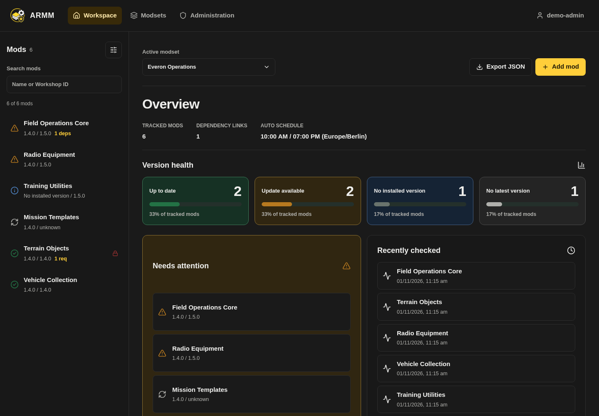

# Arma Reforger Mod Manager (ARMM)

ARMM is a web application for managing and monitoring Arma Reforger Workshop mods.
It stores mod data per user-owned modset, regularly refreshes Workshop metadata, compares installed and latest versions, and centralizes updates, dependency relations, sharing, and audit events in one UI.



*Current interface with fictional demonstration data. [More screenshots](docs/screenshots.md).*

**Current release: 0.2.7.** Includes [parent/child modsets and list-based export ordering](docs/parent-child-modsets.md), binding inherited versions, parent-controlled ordering and Child mods first. Deployment examples select `0.2.7`. See [release notes](docs/releases/0.2.7.md) and the [upgrade guide](docs/upgrading.md).

**Current source (`main`):** also includes estimated modset size, corrected Workshop file-size extraction, and dashboard/browser navigation improvements added after 0.2.7. These changes are not included in the published 0.2.7 images. It also adds [scoped sync access](docs/sync-access.md) on this feature branch. See [unreleased changes](docs/unreleased.md); use a [source build](docs/development.md) to review them.

[User guide](docs/user-guide.md) · [Documentation index](docs/README.md) · [Upgrade guide](docs/upgrading.md) · [Wiki](https://github.com/morok101st/Arma-Reforger-Mod-Manager/wiki)

## What the application does

- Tracks Workshop mods by mod ID.
- Reads Workshop metadata from the Workshop pages and can use a dedicated internal Reforger metadata service for manual reliable latest-version checks.
- Supports private, user-owned modsets and admin-managed groups. Owners grant selected groups read or write access, including access for existing service accounts.
- Compares `Installed Version` vs. `Latest Version`.
- Uses a dedicated `No installed version` state for tracked mods without an installed target version.
- Runs an automatic crawl twice per day at fixed times. Scheduled crawls use Workshop scraping only and do not call the Reforger CLI metadata service.
- Shows dependency and `Required by` relations between tracked mods.
- Automatically adds dependencies to tracking when an installed version is set.
- Preserves dependency origin information even when a dependency mod is later edited manually.
- Can optionally set orphaned dependency mods to `No installed version` when a parent mod is deleted or deactivated.
- Stores changelog history per version including `Last modified`.
- Exports a modset as a JSON list (`modId`, `name`, `version`) for mods with a defined version only.
- The current source estimates modset size from Workshop metadata for installed mods, counting local, inherited and dependency mods once per ID. Unknown sizes are identified separately; actual disk usage can differ.
- Supports per-modset export order. The editor displays list positions and saves moves; legacy numeric API calls remain compatible.
- Can send Discord update alerts through admin-managed webhooks without code changes.
- Discord webhooks can be scoped to selected modsets so alerts only fire for the modsets you choose.
- Discord update alerts can link directly back into ARMM for the affected mod and modset.
- Discord update alerts are emitted only during the scheduled automatic runs.

## Using the interface

- **Workspace:** the active modset selector, Export JSON and Add mod sit above the overview or selected mod. The desktop mod browser contains search, status filters and sorting; on phones it opens as a drawer.
- **Overview:** Version health distinguishes Up to date, Update available, No installed version and No latest version. Selecting a category filters the browser. Needs attention lists updates and missing latest versions; mods without an installed version are intentionally neutral. Export order and the paged modset Changelog are collapsible.
- **Mod details:** copy the Workshop ID, compare installed/latest versions, check updates, choose a known installed version, inspect dependencies/Required by, or copy a single JSON entry when an installed version exists. Running manual checks remain visible after reload and in other tabs.
- **Modsets:** search by name or owner, filter owned/group-access modsets, and open a modset from its name. Edit combines its name and group permissions. Export is visible; Duplicate and Delete are in the additional actions menu. Copies start private without group grants or webhook scope membership. The last remaining modset is protected.
- **Administration:** administrators have separate Users, Groups, Discord and Audit log sections, plus **Sync access** on the feature branch for creating sync access through a wizard and managing saved configurations as rows. The user editor saves role, account status, memberships and an optional password together. Personal Account settings, theme switching and Sign out are in the account menu; regular users see Settings instead of Administration.
- **Navigation and recovery:** copied URLs, reload and browser Back/Forward retain the selected view/modset/mod. Failed reads show an error and Retry rather than misleading empty lists. Successful writes are not repeated when a following list reload fails. Dialogs and selects support keyboard navigation and retain drafts after errors.

See the [user guide](docs/user-guide.md) for permissions, keyboard controls, URL examples and daily workflows.

## Security features

- Login required for all management endpoints.
- `GET /api/health` is public; login/configuration and enabled OIDC entry/callback routes are also reachable without an existing session. Management data and API documentation require login.
- Role model: `admin` and `user`.
- Initial admin user is bootstrapped from `.env` at startup.
- Password hashing with `PBKDF2-SHA256` (`210000` iterations).
- Minimum password length: 12 characters (user creation, reset, own password change).
- Username login is case-insensitive.
- Login rate limit: 8 failed attempts per 60 seconds (per IP + username).
- Session stored in a signed HttpOnly cookie (`armm_session`, 7-day TTL).
- Password changes, password resets, and role changes invalidate existing sessions immediately.
- Production startup fails fast if `ARMM_SECRET_KEY` is missing or left at a placeholder value.
- Cookie flags: `HttpOnly`, `SameSite=Lax`, and `Secure` in production.
- Logout clears the session cookie.
- OIDC logout clears only the ARMM session cookie; the central provider/SSO session may remain active.
- Origin validation for unsafe HTTP methods (additional CSRF protection via origin allowlist).
- Audit trail for login/logout, password actions, user changes, mod changes, modset changes, and webhook changes.
- Modset ownership and group permissions are persisted and enforced server-side.
- Group permissions are checked server-side on every request. The strongest applicable group permission wins; legacy `shared` values never grant access. Owners and administrators can delete modsets or manage grants.
- Discord webhook targets are stored server-side and alerts are deduplicated per webhook, modset, mod, and latest version.
- Discord update alerts are only sent from the scheduled automatic runs at `10:00` and `19:00` in the configured deployment timezone.
- Discord webhook URLs are stored encrypted server-side and only shown in masked form in the UI.
- Each Discord webhook can be assigned to one or more modsets; if no explicit scope is chosen on creation, it defaults to all current modsets.
- Discord notification links use `ARMM_PUBLIC_URL` when configured, otherwise they fall back to the first `CORS_ORIGINS` entry.
- Frontend Nginx adds security headers (including CSP, X-Frame-Options, Referrer-Policy, nosniff).
- API documentation is protected and available only for authenticated users (`/api/docs`, `/api/openapi.json`).
- The browser path `/api` redirects to `/api/docs` in the frontend container.

## API overview

Base path behind the frontend proxy: `/api`

- `GET /api/health` (public)
- `POST /api/auth/login`
- `POST /api/auth/logout`
- `GET /api/auth/config`
- `GET /api/auth/oidc/login`
- `GET /api/auth/oidc/callback`
- `GET /api/auth/me`
- `PATCH /api/auth/password`
- `PATCH /api/auth/theme`
- `GET/POST/PATCH/DELETE /api/mods...`
- `PATCH /api/mods/{mod_id}?deactivate_orphan_dependencies=true`
- `DELETE /api/mods/{mod_id}?deactivate_orphan_dependencies=true`
- `POST /api/mods/{mod_id}/refresh` (existing synchronous response)
- `POST /api/mods/{mod_id}/refresh-job` (202; start or join an individual manual job)
- `GET /api/refresh-jobs` (latest job status per tracked mod in the selected modset)
- `POST /api/refresh` (manual bulk check of the selected modset)
- `GET/POST/PATCH/DELETE /api/modsets...`
- `POST /api/modsets/{modset_id}/activate`
- `POST /api/modsets/{modset_id}/duplicate`
- `PUT /api/modsets/{modset_id}/export-order` (complete ordered `mod_ids` list)
- `PATCH /api/modsets/{modset_id}/load-order` (numeric compatibility endpoint)
- `GET /api/modsets/{modset_id}/activity` (`limit`, `offset`)
- `GET /api/modsets/{modset_id}/export`
- `GET/POST/PATCH/DELETE /api/users...` (admin)
- `PATCH /api/users/{user_id}/password` (admin)
- `GET/POST/PATCH/DELETE /api/discord-webhooks...` (admin)
- `GET /api/admin/modsets` (admin, used for webhook modset selection)
- `GET /api/groups` (signed-in group directory, names and IDs only)
- `GET/POST /api/admin/groups`, `PUT/DELETE /api/admin/groups/{group_id}` (admin)
- `PUT /api/admin/users/{user_id}/groups` (admin, replaces that user's memberships)
- `GET/PUT /api/modsets/{modset_id}/group-permissions` (owner or admin)
- `POST /api/discord-webhooks/{webhook_id}/test` (admin)
- `GET /api/audit` (admin, `limit`, `offset`)
- `GET /api/scheduler/status`
- `GET /api` (browser entry, redirects to `/api/docs`)
- `GET /api/docs` (authenticated)

See [API and automation](docs/api.md) for cookie authentication, permissions, atomic user updates and job handling.

## Installation (Docker Compose)

### Prerequisites

- Docker + Docker Compose plugin
- Reverse proxy/Traefik network `traefik_default` (as referenced in the example compose file)

### 1. Prepare configuration

```bash
cp .env.example .env
cp docker-compose.example.yml docker-compose.yml
```

### 2. Set required values in `.env`

At minimum, change these values:

- `ARMM_SECRET_KEY`
- `ARMM_ADMIN_PASSWORD`
- `ARMM_PUBLIC_URL`
- `ARMM_SCHEDULER_TIMEZONE`
- `POSTGRES_PASSWORD`
- `DATABASE_URL` (including the correct DB password)
- `CORS_ORIGINS` for your domain
- `ARMM_IMAGE_TAG` if you want to pin the example stack to a specific release tag
- `ARMM_SECRET_KEY` must be set to a unique strong value in production. There is no fallback secret anymore.

`ARMM_PUBLIC_URL` should point to the externally reachable ARMM URL, for example `https://armm.example.com`. It is used for Discord notifications that link directly back to the affected mod inside ARMM.

`ARMM_SCHEDULER_TIMEZONE` defines the deployment timezone used for the automatic runs. ARMM checks for updates twice per day at `10:00` and `19:00` in that timezone.

`WORKSHOP_METADATA_PROVIDER` controls the metadata provider used for reliable/manual refreshes. The default `reforger` uses the hybrid Workshop scraper plus internal Reforger metadata service flow. Use `scraper` only if you intentionally want to disable the Reforger metadata service.

`REFORGER_METADATA_URL` points the backend to the internal metadata service. In the standard Compose deployment this should stay `http://reforger-cli:8081`.

`REFORGER_METADATA_TIMEOUT_SECONDS` controls how long the backend waits for the internal Reforger metadata service before treating the reliable metadata lookup as failed.

Also adjust Traefik host/domain labels in `docker-compose.yml` for your environment.

### 3. Start the stack

```bash
docker compose up -d
```

### 4. Verify

- Health: `https://<your-domain>/api/health`
- Frontend login: `https://<your-domain>/`
- Browser entry for authenticated API docs: `https://<your-domain>/api`
- API docs (after login): `https://<your-domain>/api/docs`

Note: The automatic crawl runs twice per day at `10:00` and `19:00` in `ARMM_SCHEDULER_TIMEZONE`. Discord update alerts are emitted only from those automatic runs, not from manual refreshes or manual version edits. Scheduled automatic crawls use Workshop scraping only; they do not call the internal Reforger CLI metadata service.

## Workshop Metadata

ARMM uses a hybrid Workshop metadata strategy.
Dependencies, changelog entries, descriptions, and other display metadata are still read from the Workshop pages.
For manual reliable checks, the latest mod version is read through an internal `reforger-cli` container because the Workshop pages can lag behind the backend data used by Arma Reforger.

The `reforger-cli` service installs or updates the Arma Reforger Dedicated Server through SteamCMD on startup, keeps the installation in the `reforger-server-data` Docker volume, and exposes an internal metadata API for the backend.

This avoids relying on cached Workshop website HTML for manual latest-version verification while keeping the richer dependency and changelog parsing from the Workshop pages. The Bohemia tooling may still download or materialize mod files while resolving version metadata; those files stay isolated inside the `reforger-cli` container volume and are not stored in the backend container.

Manual reliable metadata lookup flow:

- ARMM receives a mod ID from the UI.
- The backend scrapes the Workshop detail and changelog pages for metadata, dependencies, and version history.
- The backend also calls the internal `reforger-cli` metadata API for the same mod ID.
- The metadata service starts `ArmaReforgerServer` in headless mode with a temporary config for that mod.
- The service watches the temporary profile until the root mod `ServerData.json` is available and stable.
- The service terminates the Arma server process and returns the version from the root `ServerData.json`.
- The backend stores the scraped metadata but overrides the latest version with the Reforger CLI value.
- Dependencies discovered by scraping are refreshed recursively, so transitive dependencies can still be tracked.
- Temporary probe data is deleted after each lookup unless debug retention is explicitly enabled in the service environment.

No external port is published for the metadata service. It is only reachable from the Docker network at `http://reforger-cli:8081`.

Scheduled metadata lookup flow:

- The scheduler runs at `10:00` and `19:00` in `ARMM_SCHEDULER_TIMEZONE`.
- Scheduled runs use Workshop scraping only for metadata, version history, dependencies, and Discord update detection.
- Scheduled runs intentionally skip the internal Reforger CLI metadata service to reduce server load.
- Manual mod refreshes still use the hybrid strategy and can correct the latest version with the Reforger CLI value.

## Export load order

Arma Reforger uses the order of entries in the exported `mods` array as the server load order.
The UI manages export order as a list with positions **1, 2, 3…**.

- Move mods to the top, up, down or to the bottom; changes save automatically.
- Existing order is preserved, including tie-breaking for previously equal values.
- Browser/sidebar sorting remains separate from export order.
- A child modset can follow its parent order and insert local mods, or keep its own independent order. See [parent/child modsets](docs/parent-child-modsets.md).
- The UI saves complete ordered mod-ID lists. Numeric values remain internal and existing numeric API calls stay compatible.

## Operations

- Configure the deployment timezone for automatic runs with `ARMM_SCHEDULER_TIMEZONE` in `.env`.
- `ARMM_ADMIN_USERNAME` / `ARMM_ADMIN_PASSWORD` bootstrap the first admin only. Once an admin exists, changing these variables does not reset its credentials; use Account settings or administrator user management.
- Modsets are user-scoped. The creator becomes the owner; other users need an explicit group grant.
- Private modsets can also be shared with selected groups. For setup, service-account API examples, and upgrading existing 0.2.4 deployments, see [Group sharing and upgrades](docs/group-sharing-upgrade.md).
- Manual update checks survive reloads and reconnects. See [persistent checks and upgrading from 0.2.5](docs/manual-refresh-upgrade.md) for API compatibility and deployment instructions.
- Manual `POST /api/refresh` is limited to the selected authorized modset (`modset_id`, or the active modset if omitted). Scheduled checks still cover all tracked modsets.
- Adding a mod or changing a mod's installed version returns quickly in the UI. The request only waits for the initial Workshop scrape when a new mod is added; reliable version checks through Reforger and follow-up dependency metadata refreshes run through a small deduplicated backend queue with two workers.
- Automatic scheduled checks use scraping only. Use the manual refresh button on a mod when you explicitly want a reliable latest-version check through the Reforger CLI metadata service.
- Local production files intentionally remain unversioned: `.env`, `docker-compose.yml`.
- The example compose file uses GHCR images pinned by `ARMM_IMAGE_TAG` (currently `0.2.7`) and does not build locally. Use a source build only when reviewing changes beyond a published release.

### Optional OIDC login

OIDC can be enabled without disabling local login. Unknown OIDC users are created automatically as regular `user` accounts. Admin privileges must be assigned inside ARMM after the first OIDC login.

Minimum `.env` settings:

```env
OIDC_ENABLED=true
OIDC_ISSUER_URL=https://identity.example.com/realms/armm
OIDC_CLIENT_ID=armm
OIDC_CLIENT_SECRET=change-me-client-secret
ARMM_PUBLIC_URL=https://armm.example.com
```

Register this redirect URI at the OIDC provider:

```text
https://armm.example.com/api/auth/oidc/callback
```

If `OIDC_REDIRECT_URI` is set, it overrides the URI derived from `ARMM_PUBLIC_URL`. Keep `OIDC_SCOPES` at `openid email profile` unless the provider requires a different scope set. ARMM uses the issuer and subject claim as the stable identity and does not auto-link existing local users by email.

No OIDC logout callback URL is required for the current implementation. ARMM logout only clears the local ARMM session cookie through `POST /api/auth/logout`; it does not call the provider's single logout or end-session endpoint. For Authentik and similar providers, configure only the redirect URI above unless a future ARMM release adds RP-initiated logout.

## Deployment checklist

Before exposing ARMM to other users, verify these points:

- Replace all placeholder secrets in `.env`, especially:
  - `ARMM_SECRET_KEY`
  - `ARMM_ADMIN_PASSWORD`
  - `POSTGRES_PASSWORD`
- Keep `.env` and the productive `docker-compose.yml` local only. Do not commit them.
- Set `ARMM_PUBLIC_URL` to the exact externally reachable URL of the application.
- Set `CORS_ORIGINS` to the exact frontend origins that should be allowed.
- Adjust Traefik host/domain labels in `docker-compose.yml` to your real domain.
- Use HTTPS only at the reverse proxy layer.
- Make sure `/api`, `/api/docs`, and `/api/openapi.json` are only reachable through the intended public domain/proxy path.
- After the first production start, log in with the bootstrap admin and verify that no default credentials remain in use.
- If Discord webhooks are configured, treat them as secrets and rotate them if they were ever exposed.

## Upgrading

Use the [upgrade guide](docs/upgrading.md) to distinguish 0.2.4 → 0.2.5 group-access changes from post-0.2.5 changes. Updating from 0.2.5 adds the durable refresh-job table automatically; the visual redesign and atomic user editor add no further schema migration. Back up the database and matching `.env`, keep old/new backends separate, and reload browser tabs after updating.

## Backup and recovery

- Back up the PostgreSQL volume regularly. It contains users and session-version counters, groups and grants, modsets, tracked mods, refresh jobs, audit logs, changelog data, and encrypted Discord webhook targets. Session cookies themselves are stored by clients.
- Keep a backup of your production `.env` outside the server, because it contains required runtime secrets.
- If `ARMM_SECRET_KEY` is changed later, existing sessions become invalid and encrypted Discord webhook URLs must be re-entered and encrypted sync keys must be restored or replaced.
- Test restore procedures, not only backups. A backup is only useful if you have verified that the database and `.env` can be restored together.

Only anonymized example files are meant for Git:

- `.env.example`
- `docker-compose.example.yml`

## Troubleshooting

### Database schema checks

Use the SQLAlchemy models or current migrations as the source of truth for table and column names.
Common current names:

- Tracked mods are stored in `user_mods`, not `tracked_mods`.
- Modset ownership is stored as `modsets.owner_user_id`.
- Group access is stored in `modset_group_permissions` and `group_memberships`. The historical `modsets.shared` column remains for database compatibility and has no effect on access.
- Audit payloads are stored as `audit_logs.detail`, not `audit_logs.details`.

Errors such as `relation "tracked_mods" does not exist` or `column a.details does not exist` usually indicate an outdated manual SQL query, not an application migration failure.

## Development and CI

See [source builds and documentation tooling](docs/development.md) to build the selected source revision independently of the published image tag.

- Backend tests: `python -m unittest discover -s tests -v` (inside `backend`)
- Frontend build: `npm run build` (inside `frontend`)
- Frontend navigation tests: `npm test` (inside `frontend`, after `npm install`).
- Browser navigation tests: start the frontend with `VITE_API_BASE_URL=/api npm run dev`, run `npx playwright install --with-deps chromium`, then `ARMM_TEST_URL=http://localhost:5173 npm run test:browser` inside `frontend`. The tests mock API responses and do not modify real application data. Optional screenshots: set `ARMM_TEST_SCREENSHOTS` to an output directory.
- CI runs backend tests (including isolated PostgreSQL upgrade cases), frontend navigation tests and the production frontend build on pushes to `main` and pull requests. Browser tests run separately.
- Documentation screenshot capture: see [screenshot provenance and regeneration](docs/screenshots.md).
