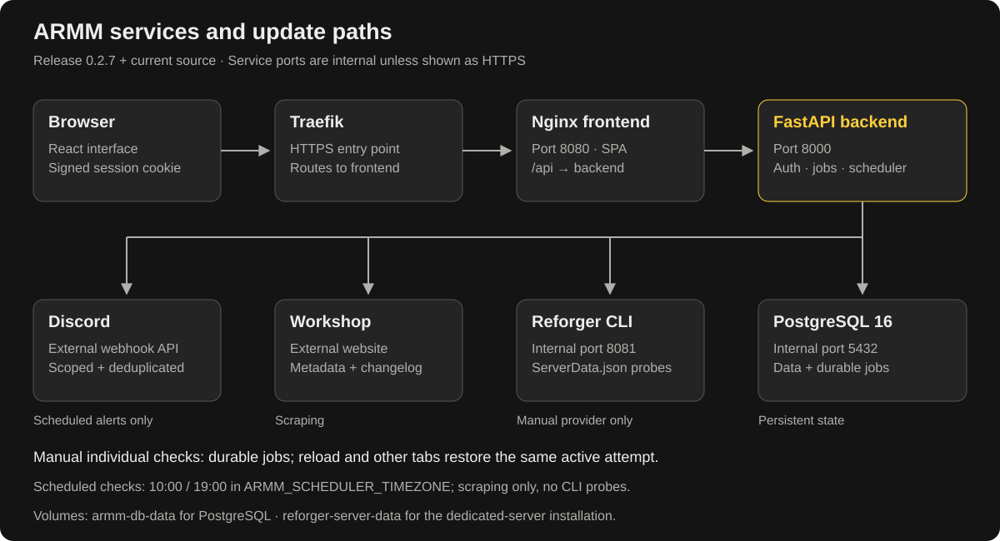
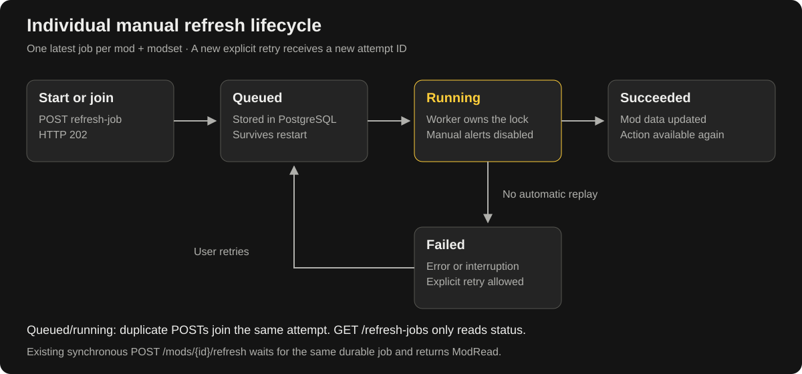

# Architecture and refresh paths

The standard deployment has four services: Nginx/React frontend, FastAPI backend, PostgreSQL 16 and internal `reforger-cli`. Traefik terminates HTTPS and routes only to the frontend's port **8080**. Nginx serves the SPA and proxies `/api/...` to backend port **8000**. The CLI metadata API uses internal port **8081**; it is not publicly exposed.

PostgreSQL stores users/session-version counters, groups/grants, modsets, tracked versions/order, changelogs, audit records, encrypted webhooks/delivery deduplication and manual-job state. The signed session cookie itself lives in the client; there is no database session table.

| Path | Execution | Metadata | Discord update alerts |
| --- | --- | --- | --- |
| Individual manual check | Durable per-mod/per-modset job, two workers per backend process; synchronous API can wait on it | Configured provider; default combines Workshop scrape with CLI latest-version verification | No |
| Add mod / change installed version | Existing process-local deduplicated background metadata queue | Initial add scrapes first; follow-up reliable metadata/dependencies run in background | No |
| Manual bulk check | Existing selected-modset bulk refresh path | Configured manual provider | No |
| Scheduled check at 10:00 / 19:00 | Backend scheduler, configured timezone, all tracked modsets | Workshop scraping only; no CLI probe | Yes, scoped and deduplicated |

Jobs use a unique modset/mod key and a new attempt ID on retry. PostgreSQL session advisory locks prevent another worker executing or recovering a still-active check. An owner-process exit releases its lock; a worker marks the interrupted running job failed without replaying it. Queued jobs remain discoverable after restart. The browser polls status rather than holding a long request open.

The `armm-db-data` volume contains PostgreSQL data; `reforger-server-data` contains the dedicated-server installation. Metadata probes create temporary profiles inside the CLI service and clean them up unless debug retention is enabled. No new queue service or Redis is needed for persistent manual jobs.

See [deployment examples](../docker-compose.example.yml), [job internals and migration](manual-refresh-upgrade.md), and the [Traefik chapter](https://github.com/morok101st/Arma-Reforger-Mod-Manager/wiki/Traefik-and-Reverse-Proxy). This diagram describes current `main`; durable jobs were added after 0.2.5.
