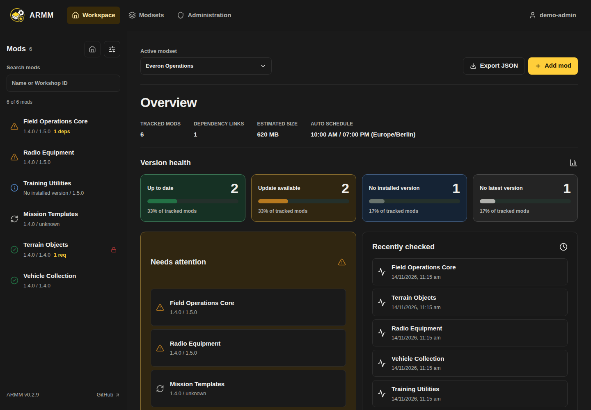
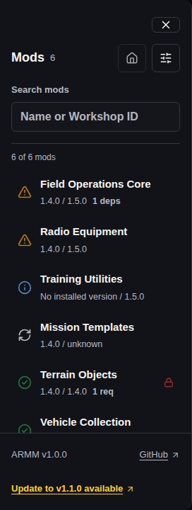
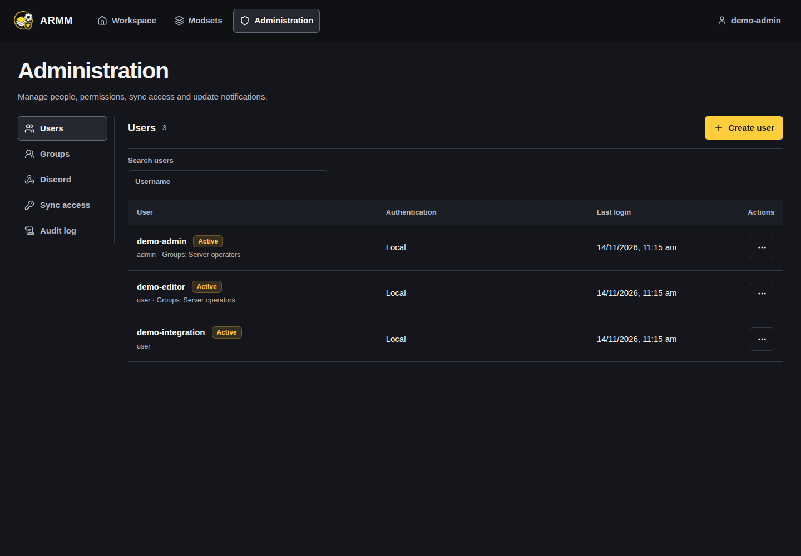
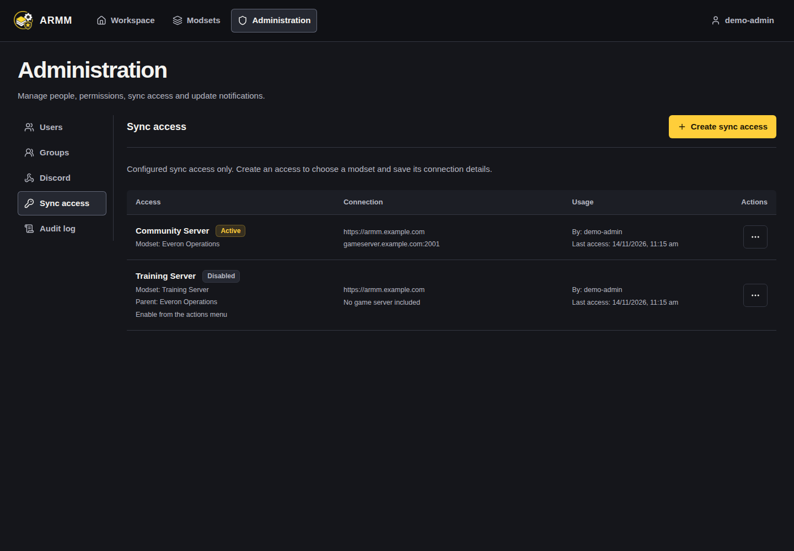
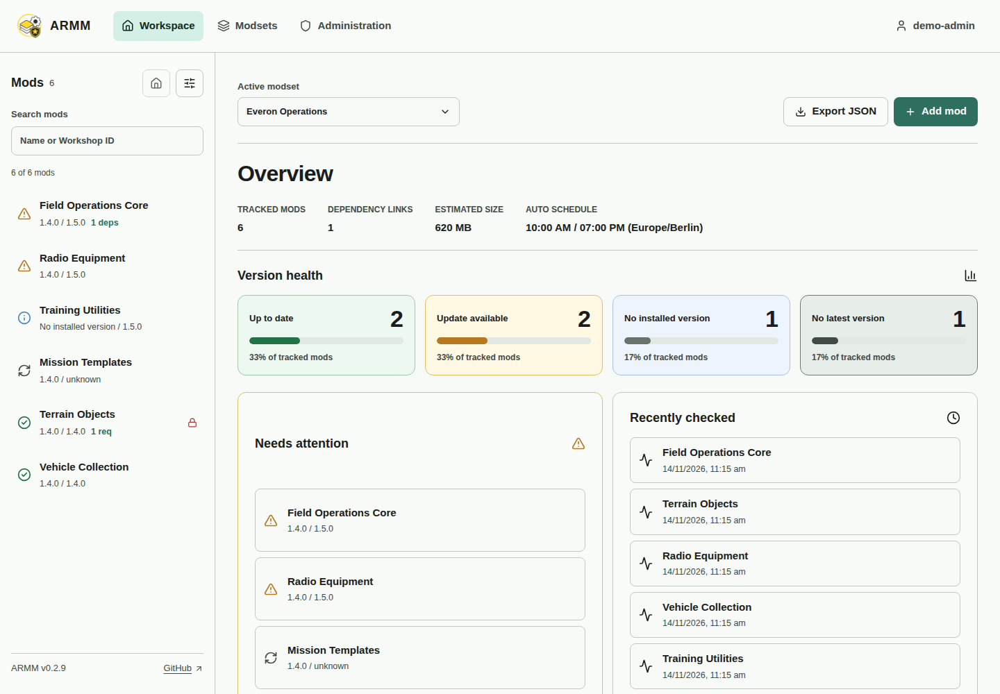

# Interface gallery

All captures use **fictional demonstration data**. The desktop workspace and mod detail screenshots show the version and GitHub link from `main`. Their version number is an example. The older Modsets, Administration, Sync access and closed-drawer mobile captures show **0.2.8**. The capture instructions below use a read-only mocked API fixture.

## Workspace



Global navigation, the active-modset toolbar and four Version health categories. Export order and modset activity remain collapsible below the overview.

## ARMM version and release updates

These captures show the interface from `main` with a simulated newer release. The running version and repository link are available to signed-in users. The update link is visible to administrators when a newer stable release is available.




The navigation browser test captures these examples when `ARMM_TEST_SCREENSHOTS` is set. The API responses use fictional data.

## Mod detail


The Workshop ID has its own copy action. Installed/latest comparison, checks and dependency relationships stay together.

## Modsets


Names open the workspace; Edit combines name and group permissions. Edit, Export, Duplicate and Delete live in additional actions.

## Administration



Users, Groups, Discord and Audit log are separate sections. Personal Account settings are accessed independently.

## Sync access



Only configured accesses are listed, with Edit, Download and Disable actions.


The wizard collects a modset, name and connection hints before final confirmation. This capture does not submit the wizard or create credentials.

## Light mode and mobile




The mobile browser opens as a drawer. These viewport captures demonstrate layout; they do not claim physical-device or manual screen-reader certification.

## Reproduce the captures

From `frontend`, install the existing development dependencies and Chromium, start the frontend with the internal API base, then run the capture script in another terminal:

```bash
npm ci
npx playwright install --with-deps chromium
VITE_API_BASE_URL=/api npm run dev
```

```bash
cd frontend
ARMM_DOCS_URL=http://localhost:5173 node scripts/capture-docs.cjs
```

The default output is `../docs/images` relative to the working directory; override with `ARMM_DOCS_OUTPUT`. The script intercepts all API reads, rejects mutations/unmocked external requests, fixes locale/timezone/viewport and uses deterministic example data. Desktop captures are 1440×1000; mobile is 390×844. Captures use the application's DOM/CSS, not hand-drawn UI mockups.

`architecture.svg` and `manual-refresh.svg` are editable vector diagrams of code behavior. They complement the screenshots; they are not generated product illustrations. Keep wiki image copies synchronized when publishing documentation.
