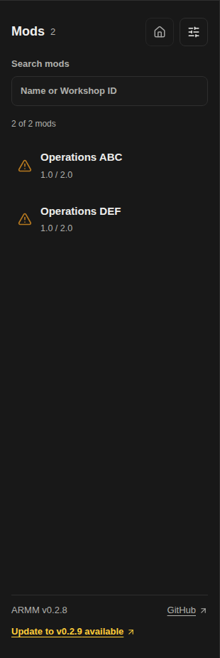
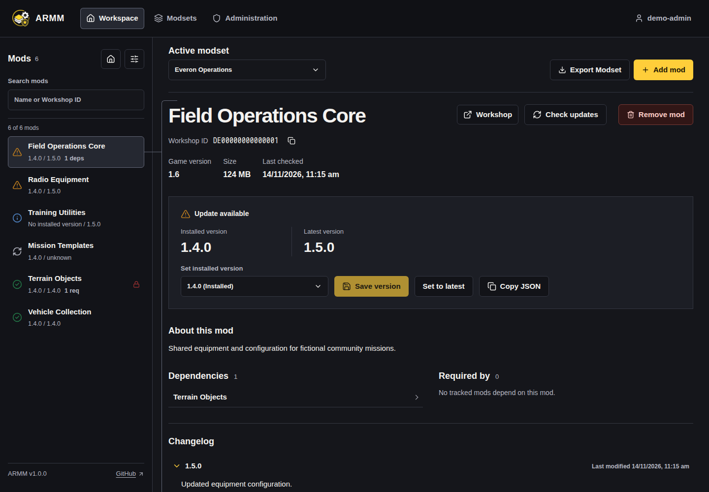
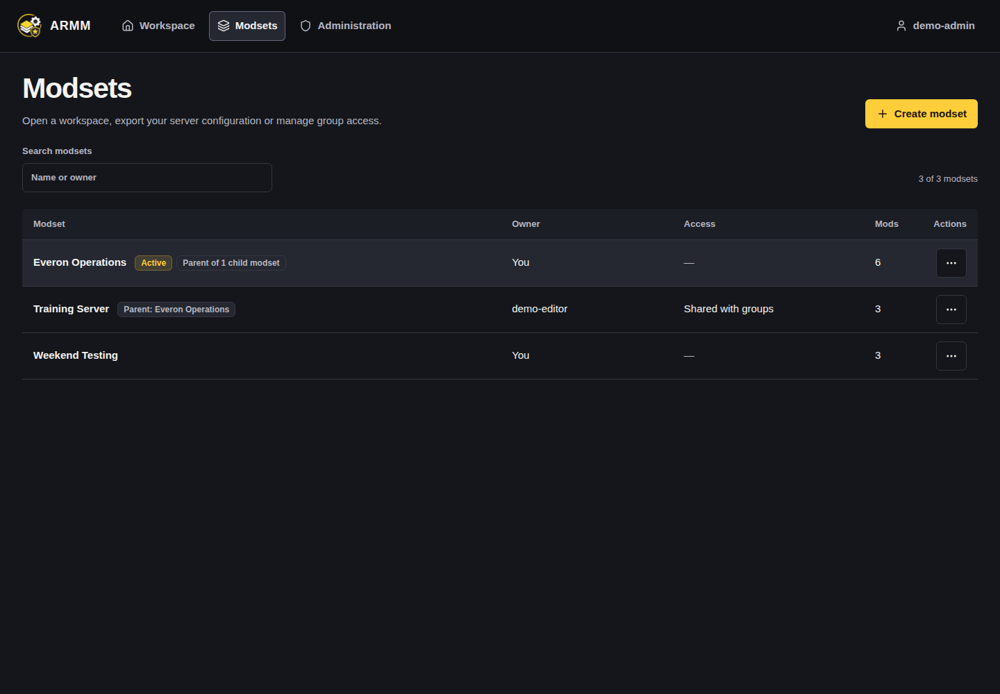
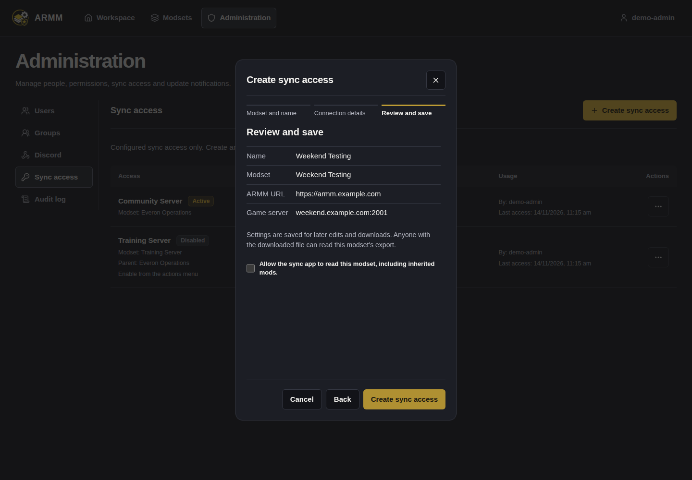
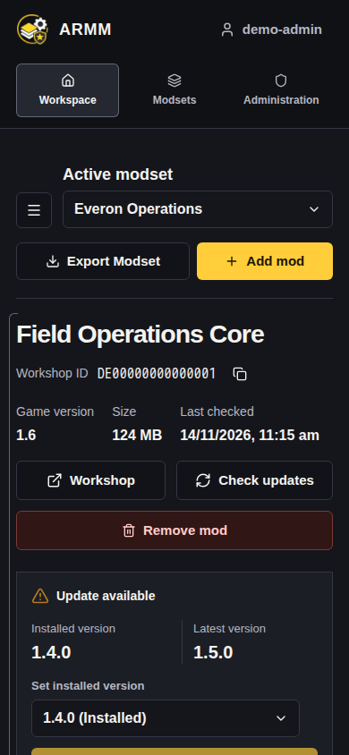

# Interface gallery

All captures show the current `main` interface with **fictional demonstration data**. Build versions, account names and server details are illustrative. The capture script uses a read-only mocked API fixture.

## Workspace


Global navigation, the active-modset toolbar and four Version health categories. Export order and modset activity remain collapsible below the overview.

## ARMM version and release updates

These captures show a simulated update from 1.0.0 to 1.1.0. The running version and repository link are available to signed-in users. The update link is visible to administrators when a newer stable release is available.




The capture script saves these two examples as sidebar crops.

## Mod detail



The Workshop ID has its own copy action. The selected row connects to the detail view on desktop. The version comparison appears above the description, dependencies and changelog.

## Modsets



Names open the workspace; Edit combines name and group permissions. Edit, Export, Duplicate and Delete live in additional actions.

## Administration


Users, Groups, Discord, Sync access and Audit log are separate sections. The administration tables share a three-dot actions menu. Personal Account settings are accessed independently.

## Sync access


Only configured accesses are listed. The actions menu separates Edit, Download, Enable or Disable, Renew key and Delete.



The wizard collects a modset, name and connection hints before final confirmation. This capture does not submit the wizard or create credentials.

## Light mode and mobile




The mobile browser opens as a drawer. These viewport captures demonstrate layout; they do not claim physical-device or manual screen-reader certification.

## Reproduce the captures

From `frontend`, install the existing development dependencies and Chromium, start the frontend with the internal API base, then run the capture script in another terminal:

```bash
npm ci
npx playwright install --with-deps chromium
VITE_API_BASE_URL=/api npm run dev
```

```bash
cd frontend
ARMM_DOCS_URL=http://localhost:5173 node scripts/capture-docs.cjs
```

The default output is `../docs/images` relative to the working directory; override with `ARMM_DOCS_OUTPUT`. The script intercepts all API reads, rejects mutations/unmocked external requests, fixes locale/timezone/viewport and uses deterministic example data. Desktop captures use a 1440×1000 viewport. The mobile detail uses 390×844 and the cropped mobile drawer uses a 320×720 viewport.

`architecture.svg` and `manual-refresh.svg` are editable vector diagrams of code behavior. They complement the screenshots; they are not generated product illustrations. Keep wiki image copies synchronized when publishing documentation.
